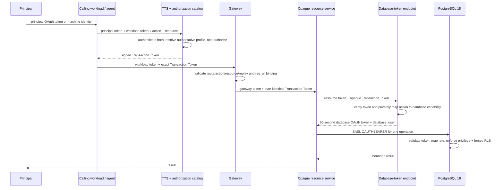

# Custody architecture

## Purpose

Custody explores whether principal authority can survive an intermediary-heavy
call chain all the way to PostgreSQL without granting standing data permissions
to the services in that chain. It combines short-lived signed context, shared
operation roles, forced RLS, and immutable database-session identity.

The architecture minimizes implicit trust; it does not eliminate trust. The
trusted computing base includes Keycloak, both token issuers and signing keys,
the authorization catalog, the gateway, PostgreSQL and its validator/policies,
and the database schema.

## Domain vocabulary

| Field | Meaning | Example |
|---|---|---|
| `sub` | Principal exercising authority | `demo-patient` |
| `principal_kind` | Identity category | `human`, `autonomous_agent`, `external_machine` |
| `act` | Optional delegated actor | `agent-42` |
| `req_wl` / `wl` | Workload executing the transaction | `agent-42`, `demo-app` |
| `org_id` | Signed tenant boundary | organization A UUID |
| `access_profile` | Row-authority basis | `patient_self`, `provider_assigned`, `org_scoped` |
| `action` | Canonical business operation | `schedule.appointment.create` |
| `resource` | Typed, signed target | provider 17 / slot 812 |
| `db_role` | Concrete operation capability; database token only | `custody_schedule_appointment_creator` |
| `txn` | Cross-layer correlation identifier | UUID |

Identity category, row scope, and operation are intentionally separate. An
autonomous principal can have `provider_assigned` row authority without
pretending to be a human provider. Multiple kinds can exercise the same shared
operation role while retaining distinct attribution.

## Trust boundaries and call path



Compose networks document intended topology but are not authorization controls.
Every protected boundary authenticates its immediate peer. Only components that
trust Transaction Token claims need to parse them: the gateway and database-token
endpoint do; the database-only resource hop deliberately does not.

## Four principal paths

| Path | Authority subject | Delegated actor | Example |
|---|---|---|---|
| Direct end user | Human | None | patient-self or assigned-provider read |
| Human through agent | Human | Chat agent | view availability, then schedule |
| Autonomous internal agent | Agent identity | None | provisioned provider-assigned read |
| External API caller | Machine client | None | organization export |

An app, API, gateway, or resource service is an execution workload, not
automatically the authority subject. Its client credential alone is insufficient
for database-token issuance and carries no patient-data permission.

## Token lifecycle

### Principal and workload credentials

Human tokens and service-account tokens come from Keycloak. The TTS verifies
the principal credential and the independently authenticated calling workload.
For machine principals, the client credential identifies both the principal and
the initial calling workload, but those concepts remain explicit in the issued
claims.

The principal token stops at transaction ingress. It is not propagated through
the internal call chain.

### Transaction Token

Custody pins `draft-ietf-oauth-transaction-tokens-11`. Its protected JWT has
`typ: txntoken+jwt` and carries:

| Claim | Purpose |
|---|---|
| `iat`, `exp`, `aud` | Bounded validity in the Custody trust domain |
| `txn` | Immutable cross-layer correlation |
| `sub`, optional `act` | Authority principal and delegated actor |
| `req_wl` | Workload that obtained this authority |
| `action`, `resource` | Authorized business operation and typed target |
| `principal_kind`, `access_profile`, `org_id` | Authoritative identity and row context |
| optional `patient_id`, `provider_id` | Profile-specific context |

Callers submit only an action and typed resource. They cannot submit tenant,
profile, database capability, or database role. Internal HTTP sends exactly one
compact token in `Txn-Token`; normal hops forward those bytes unchanged.

Replay detection is receiver-scoped because one valid transaction must cross
several receivers. The gateway consumes a token once locally, while the
database-token endpoint separately consumes it once for issuance.

### Database access token

PostgreSQL receives a distinct `at+jwt` with its own issuer, audience, signing
key, 30-second lifetime, and unique `jti`. It repeats the verified transaction
context and adds:

- `wl`: the authenticated data-layer workload;
- the concrete `db_role` privately selected from `action`;
- PostgreSQL's required `custody.database` OAuth scope.

The database-token endpoint rejects caller-supplied `db_role`, `db_capability`,
`org_id`, and `access_profile`. The C validator independently checks signature,
type, issuer, audience, time, scope, action-to-role mapping, identity fields, and
the PostgreSQL-requested username before returning `authn_id`.

### Why two exchanges?

A direct principal-to-database exchange is reasonable for an immediate,
single-service query. Custody's scenarios contain agents, gateways, APIs, and a
scheduling/resource service. The Transaction Token consumes the general-purpose
principal token at ingress and carries an attenuated action/resource authority
through those intermediaries. The database credential is minted only at the
last responsible moment and cannot be mistaken for general transaction context.

## Authorization catalog

Phase 2A uses a small in-process authoritative catalog so the security seams are
visible. It resolves fixture entitlements and performs this sequence:

1. authenticate principal and workload;
2. find the principal's provisioned `principal_kind`, tenant, and access profile;
3. verify that both identities are permitted to request the action;
4. validate the typed resource and any provider/patient binding;
5. issue a Transaction Token containing only the resulting authority;
6. at database exchange, map the already-authorized action to one capability.

The private action mapping is:

| Action | Database role |
|---|---|
| `patient-records.read` | `custody_patient_records_reader` |
| `schedule.availability.read` | `custody_schedule_availability_reader` |
| `schedule.appointment.create` | `custody_schedule_appointment_creator` |
| `patient-records.export` | `custody_org_exporter` |
| `patient-records.import` | `custody_patient_importer` |

Phase 2B can replace the catalog's decision function with an AuthZEN endpoint
without exposing database-role selection to callers. Approval remains a planned
extension: a requestable denial must be followed by a fresh allow decision that
contains approval evidence before capability issuance.

## PostgreSQL enforcement

PostgreSQL exposes two identities honestly:

- `system_user`: validator-controlled, immutable OAuth identity;
- `current_user`: the shared operation role requested for this connection.

The validator emits this bounded v2 identity:

```text
oauth:v2:<org>:<principal_kind>:<subject>:<access_profile>:<patient-or-none>:<provider-or-none>:<resource-provider-or-none>:<slot-or-none>:<txn>
```

`pg_ident.conf` maps a structurally valid identity to one of five pre-provisioned
operation roles. The validator already required the token's action, role, and
requested PostgreSQL username to agree; the mapping is an additional boundary,
not the primary policy engine.

Protected objects are owned by a separate `NOLOGIN` role. Runtime roles are
non-superuser and `NOBYPASSRLS`; protected tables use `FORCE ROW LEVEL SECURITY`.
A restrictive tenant policy is combined with profile-specific policies:

- `org_scoped`: rows in the signed organization;
- `provider_assigned`: patients assigned to the signed provider subject;
- `patient_self`: only the signed patient ID.

Public availability is structurally separated from the private provider
calendar. Appointment creation uses an executable function instead of table
INSERT privilege; security-sensitive values are parsed from `system_user` and
cannot be supplied by the workload.

Per-principal OAuth sessions are intentionally in tension with pooling. The POC
uses a new physical connection for each operation because `system_user` is fixed
at authentication. It does not trust application-set GUCs or `SET LOCAL` claims.

## Database public-key distribution

The TTS keeps its Transaction Token and database-token private keys in a private
volume. At startup it atomically publishes only the database issuer's raw
Ed25519 public key into a separate volume. PostgreSQL mounts that volume
read-only and validates database tokens without a runtime network dependency on
the TTS. Startup fails if publication fails, and PostgreSQL waits for a healthy
TTS before starting.

The HTTP database JWKS endpoint remains available for inspection, but no
dedicated synchronization process or machine credential is required.

## Operational logging

Each workload emits redacted JSON teaching logs so the live exchange and
authorization decisions are visible during the demo. PostgreSQL's validator
logs bounded accept/reject context. These logs are diagnostic output, not a
durable audit design and never participate in authorization.

## Invariants

1. A Transaction Token is never a workload or database access credential.
2. A principal token does not cross the internal service chain.
3. Normal hops forward the exact Transaction Token; opaque hops do not trust it.
4. Every component validates before trusting claims or causing a non-database side effect.
5. The authenticated gateway caller must equal signed `req_wl`.
6. No caller-facing request accepts tenant, access profile, database capability, or role.
7. A workload credential alone never produces patient-data authority.
8. Database role selection is a private, exact action mapping.
9. PostgreSQL independently validates the database token and requested role.
10. Signed session identity—not application state—drives RLS.
11. Restrictive tenant RLS is combined with row-profile policy on forced-RLS tables.
12. Protected owners do not log in and runtime roles cannot bypass RLS.
13. Credentials, compact tokens, rows, and bind values are never logged in full.
14. `txn` correlates operational events; it does not by itself authorize or prevent replay.

## Historical phases

Phase 0 proved PostgreSQL 18's OAuth validator interface and fail-closed path.
Phase 1 replaced the sentinel with real Ed25519 verification, Keycloak identities,
byte-identical Transaction Token propagation, and forced multi-tenant RLS.
Phase 2A generalized authority, replaced persona roles with
operation capabilities, added four principal paths, and implemented the
availability/appointment scenario.

## Non-goals

The POC does not implement production entitlement administration, real calendar
integrations, an approval UI/workflow, generated gRPC integration, mTLS/SPIRE,
managed-database compatibility, HA, formal verification, or production key
management.
