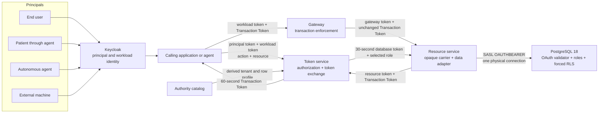
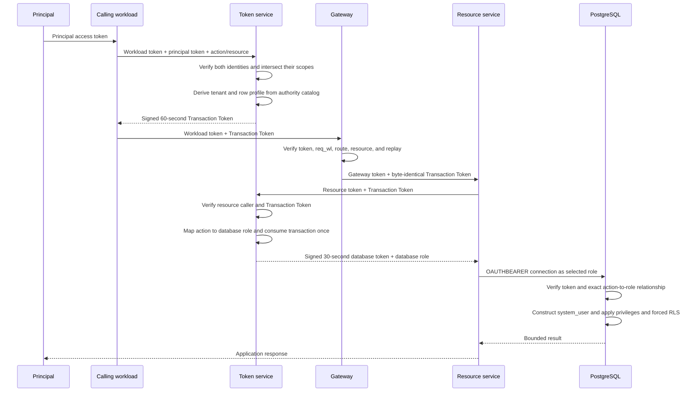

# Zero-Trust Authorization Through Application Workloads to PostgreSQL

This repository demonstrates an application architecture in which users,
delegated agents, autonomous agents, and external machines can access data
through application workloads without granting those workloads standing access
to the data.

Authority begins with an authenticated principal. It is narrowed to one
business action and resource, carried through intermediary workloads in a
short-lived Transaction Token, exchanged for a separate 30-second PostgreSQL
access token, and enforced by PostgreSQL privileges and row-level security.

The application workloads execute requests, but they do not decide which
tenant, rows, or database role a principal receives.

The implemented scenarios are:

- an end user accessing records through an application;
- a patient using a chat agent to view availability and schedule an appointment;
- an autonomous internal agent with provider-scoped authority;
- an external machine exporting records from one organization.

## Goals and controls

| Goal | Architectural control |
|---|---|
| Remove ambient data authority from application workloads | Workload credentials authenticate services but cannot independently obtain a database token or access patient data |
| Preserve the authority of the actual caller across intermediaries | A signed Transaction Token carries the principal, optional delegated actor, requesting workload, action, resource, tenant, and row-access profile |
| Prevent callers from selecting their own database permissions | Callers request business actions and typed resources; the token service privately maps authorized actions to database roles |
| Enforce authorization at the data tier | PostgreSQL independently validates a database-specific token, checks the requested role, applies relation/function privileges, and forces row-level security |
| Avoid one PostgreSQL role per application user | Shared roles represent operations while validator-controlled `system_user` retains the principal and row context |
| Keep delegated agents within the user's authority | The patient remains `sub`, the agent is recorded in `act`, and separate tokens authorize availability and appointment creation |
| Support non-human principals without treating an API as the principal | Autonomous agents and external clients receive their own identities, scopes, tenant context, and access profiles |
| Fail closed when credentials are malformed or substituted | Token type, key, issuer, audience, lifetime, claims, action, resource, requesting workload, and requested database role are checked at the applicable enforcement points |

## The three identities

The architecture deliberately keeps three concepts separate:

| Identity | Meaning | Example |
|---|---|---|
| Principal | The human or machine whose authority is being exercised | patient 101, provider 17, an autonomous agent, an external exporter |
| Workload | The application process carrying out the request | `demo-app`, `agent-42`, `gateway`, `resource` |
| Database capability | The narrow PostgreSQL role permitted for one operation | `custody_patient_records_reader`, `custody_schedule_appointment_creator` |

A workload identity proves which process is calling another process. It does
not imply that the workload may read patient data. A database capability says
which operation may be attempted. It does not identify the principal or define
which rows are visible.

PostgreSQL exposes this separation directly:

```text
system_user  = oauth:v2:<tenant>:<principal-kind>:<subject>:<access-profile>:...:<txn>
current_user = custody_patient_records_reader
```

`system_user` is constructed by the PostgreSQL OAuth validator from signed
claims and cannot be changed by application SQL. `current_user` is a shared
operation role. PostgreSQL combines both: privileges restrict the operation,
and RLS policies parse `system_user` to restrict the rows.

## Architecture overview



Network placement is not treated as authorization. Every protected HTTP hop
authenticates its immediate caller, and PostgreSQL validates the final
credential independently.

## End-to-end request flow



The flow uses two derived tokens because the intermediaries and PostgreSQL have
different needs:

- The Transaction Token is internal authorization context. It can cross
  multiple workloads and binds authority to a business action and resource.
- The database token is an OAuth access token for one PostgreSQL connection. It
  has a different issuer, audience, type, signing key, lifetime, and concrete
  database role.

The principal's general-purpose access token stops at the first token exchange.
It is not propagated through the internal request chain.

## Credential and token lifecycle

| Artifact | Issuer | Presented to | Lifetime | Purpose |
|---|---|---|---|---|
| Principal access token | Keycloak | Token service | Keycloak-configured | Identifies the human or machine exercising authority and carries its permitted action scopes |
| Workload access token | Keycloak | Token service or next workload | Keycloak-configured | Authenticates the process making the call; never grants patient-data access by itself |
| Transaction Token | Token service transaction issuer | Gateway, then token service at the data edge | At most 60 seconds | Carries attenuated principal authority through intermediary workloads |
| Database access token | Separate token service database issuer | PostgreSQL | At most 30 seconds | Authenticates one connection under one operation role with signed RLS context |

The Transaction Token and database token use separate Ed25519 keys. A
Transaction Token cannot be substituted as a PostgreSQL credential because its
type, issuer, audience, claims, and key are different.

## Architecture module deep dives

### Identity provider: principal and workload authentication

Keycloak supplies identities but does not assign PostgreSQL roles.

The realm contains two kinds of clients:

- The interactive CLI is a public OIDC client using Authorization Code with
  S256 PKCE, state, nonce, and an exact loopback redirect URI.
- Agents, internal workloads, autonomous principals, and external machines are
  distinct confidential clients using client credentials and narrowly assigned
  scopes.

For deterministic headless execution, the organization-administrator,
provider, and patient scenarios also use dedicated confidential clients as
synthetic principal fixtures. The interactive `alice` path separately exercises
a real human Authorization Code + PKCE login; the README does not treat the
headless fixture as proof of an interactive login flow.

The token service validates Keycloak access tokens using a pinned issuer and
audience, an allowlisted key ID, RS256, required subject/time claims, and the
authorized-party client ID. It refreshes Keycloak's public keys periodically
while retaining the last known valid set if refresh fails.

Principal and workload authentication remain separate even when the same
machine credential plays both roles. For example, the external exporter is the
principal whose authority is being exercised and the initial workload making
the call. The two concepts remain distinct in the exchange and derived token.

Relevant implementation:

- [`deploy/keycloak/custody-realm.json`](deploy/keycloak/custody-realm.json)
- [`internal/identity`](internal/identity)
- [`cmd/custody/login.go`](cmd/custody/login.go)

### Token service: authorization ingress

`POST /token` is the point where a general principal credential becomes
transaction-specific authority.

The caller supplies:

- its own workload bearer token in `Authorization`;
- the principal access token as the RFC 8693 `subject_token`;
- a canonical business action;
- a typed resource containing only fields valid for that action.

The token service then:

1. verifies the workload token and principal token independently;
2. requires both tokens to carry the requested action scope;
3. rejects caller-supplied `org_id`, `access_profile`, `db_capability`, and
   `db_role` fields;
4. asks the authority catalog to derive the principal kind, tenant, access
   profile, patient/provider association, delegated actor, and authorized
   resource;
5. creates a random transaction ID;
6. issues a signed Transaction Token with a 60-second maximum lifetime.

The caller can ask to perform `schedule.appointment.create` for provider 17 and
slot 812. It cannot ask to become an organization administrator or request the
appointment-writer database role.

Relevant implementation:

- [`cmd/tts/main.go`](cmd/tts/main.go)
- [`internal/tts/handler.go`](internal/tts/handler.go)
- [`internal/tts/identity_adapter.go`](internal/tts/identity_adapter.go)

### Authority catalog: deriving tenant and row scope

The current authority catalog is an in-process fixture that keeps the
authorization rules visible. It is the module that answers:

> May this authenticated principal, through this authenticated workload,
> perform this action on this resource, and with what row-level context?

It returns authority context rather than a database role. The implemented
profiles are:

| Principal | Kind | Access profile | Bound identity | Allowed actions |
|---|---|---|---|---|
| Organization administrator | `human` | `org_scoped` | organization A | read patient records |
| Provider | `human` | `provider_assigned` | provider 17 | read assigned patient records |
| Patient | `human` | `patient_self` | patient 101 | read own record, read provider availability, create appointment |
| Autonomous agent | `autonomous_agent` | `provider_assigned` | provider 17 | read assigned patient records |
| External exporter | `external_machine` | `org_scoped` | organization A | export organization records |

Delegated scheduling is additionally restricted to the demo patient acting
through `agent-42`, provider 17, and—in the appointment flow—slot 812.

This catalog is intentionally replaceable with an external policy decision
point later. The stable seam is the derived authority context; callers and the
database never need to learn how entitlements were stored or evaluated.

Relevant implementation:

- [`internal/authority/authority.go`](internal/authority/authority.go)
- [`internal/tenancy/directory.go`](internal/tenancy/directory.go)

### Transaction Token: attenuated authority for intermediaries

The Transaction Token is a compact EdDSA-signed JWT using the pinned
Transaction Tokens draft profile. It is carried in the dedicated `Txn-Token`
header and is not an OAuth bearer credential.

Its security-relevant claims include:

| Claim | Meaning |
|---|---|
| `sub` | Principal whose authority is being exercised |
| `act.sub` | Optional delegated actor, such as `agent-42` |
| `req_wl` | Workload that requested the Transaction Token |
| `txn` | Random transaction identifier |
| `action` | Authorized business operation |
| `resource` | Typed target, such as provider 17 and slot 812 |
| `principal_kind` | `human`, `autonomous_agent`, or `external_machine` |
| `access_profile` | `patient_self`, `provider_assigned`, or `org_scoped` |
| `org_id` | Signed tenant context |
| `patient_id` / `provider_id` | Profile-specific row context |

Verification requires one signature, EdDSA, `typ=txntoken+jwt`, the expected
key ID, exact issuer and audience, required claims, bounded identifiers, valid
action/resource shape, and a lifetime no longer than 60 seconds.

Relevant implementation:

- [`internal/txntoken/txntoken.go`](internal/txntoken/txntoken.go)
- [`testdata/contracts/transaction-token-claims.json`](testdata/contracts/transaction-token-claims.json)

### Gateway: transaction enforcement before routing

The gateway is an enforcement point because it makes a security-sensitive
routing decision. It therefore validates both identities presented to it:

1. The `Authorization` token must identify an approved calling workload.
2. The Transaction Token must have a valid signature and claims.
3. Signed `req_wl` must equal the authenticated calling workload. An approved
   workload cannot replay a Transaction Token obtained by another workload.
4. The HTTP method and path must match the signed action and resource.
5. The transaction ID must not have been consumed previously at this gateway
   instance.

After validation, the gateway acquires its own Keycloak credential for the
resource service. It forwards the compact Transaction Token byte-for-byte; it
does not reissue or normalize it.

Replay state is receiver-local. The same transaction must legitimately pass
through the gateway and later reach the database-token endpoint, so a single
global cache keyed only by `txn` would reject valid requests.

Relevant implementation:

- [`cmd/gateway/main.go`](cmd/gateway/main.go)
- [`internal/chain/chain.go`](internal/chain/chain.go)

### Resource service: opaque transaction carrier and data adapter

The resource service represents an application backend that needs to perform
data operations. Its own Keycloak credential has no patient-data authority.

It authenticates the gateway, accepts exactly one Transaction Token, and
selects one of a small set of fixed data operations from the already validated
route. It deliberately does not parse or trust Transaction Token claims. When
it needs database access, it presents the unchanged token plus its own resource
workload credential to `POST /database-token`.

The data adapter then:

1. verifies that the response contains a known database role and a token with a
   lifetime no longer than 30 seconds;
2. configures pgx with `RequireAuth = "oauth"` to prevent authentication
   downgrade;
3. supplies the token through pgx's OAuth token provider;
4. opens a new physical connection for the operation;
5. executes a fixed, parameterized query or constrained database function;
6. closes the connection immediately.

There is intentionally no cross-principal connection pool. PostgreSQL fixes
`system_user` when the physical connection is authenticated, so reusing that
session for another principal would undermine the identity model.

Relevant implementation:

- [`cmd/resource/main.go`](cmd/resource/main.go)
- [`internal/chain/chain.go`](internal/chain/chain.go)
- [`internal/data/client.go`](internal/data/client.go)

### Token service: database capability issuance

`POST /database-token` is separate from transaction ingress and is callable
only by the authenticated resource workload carrying the
`database-token.issue` scope.

The endpoint:

1. verifies the resource workload credential;
2. verifies the Transaction Token again rather than trusting the resource's
   description of it;
3. derives the database capability from the signed action using a private exact
   mapping;
4. rejects a second database-token exchange for the same transaction while the
   Transaction Token remains valid;
5. issues a database-audience OAuth token with a maximum lifetime of 30 seconds;
6. returns the corresponding PostgreSQL username to the resource.

The action-to-role mapping is:

| Authorized action | PostgreSQL role |
|---|---|
| `patient-records.read` | `custody_patient_records_reader` |
| `schedule.availability.read` | `custody_schedule_availability_reader` |
| `schedule.appointment.create` | `custody_schedule_appointment_creator` |
| `patient-records.export` | `custody_org_exporter` |
| `patient-records.import` | `custody_patient_importer` |

The import role is provisioned as a bounded extension point but is not exercised
by the current resource routes or demo.

Relevant implementation:

- [`internal/tenancy/directory.go`](internal/tenancy/directory.go)
- [`internal/dbtoken/dbtoken.go`](internal/dbtoken/dbtoken.go)
- [`internal/tts/handler.go`](internal/tts/handler.go)

### Database access token: PostgreSQL-specific authority

The database token is a compact `at+jwt` signed by an issuer and key used only
for PostgreSQL access. It includes:

- the principal in `sub` and optional delegated actor in `act`;
- the originating workload in `wl`;
- `txn` and a unique `jti`;
- the authorized `action` and typed `resource`;
- tenant, principal kind, access profile, and patient/provider context;
- the exact `db_role` selected by the token service.

The token cannot broaden the Transaction Token. Every database-token claim is
derived from a verified Transaction Token and the private action-to-role map.

### PostgreSQL OAuth validator: authentication and role consistency

PostgreSQL 18 accepts the database token through SASL OAUTHBEARER. PostgreSQL
handles the protocol exchange, then passes the raw token and requested database
role to the repository's native C validator module.

The validator performs offline checks inside the PostgreSQL authentication
process:

- bounded compact-JWT and JSON parsing with duplicate-member rejection;
- Ed25519 signature validation;
- exact `alg`, `typ`, key ID, issuer, and audience;
- `iat`/`exp` validation and a maximum 30-second lifetime;
- allowlisted principal kinds, access profiles, workloads, actor shape, and
  bounded identifiers;
- exact action-to-`db_role` mapping;
- equality between the token's `db_role` and the PostgreSQL username requested
  by the client.

If validation succeeds, the module constructs a bounded `authn_id` containing
the tenant, principal, access profile, row identifiers, signed resource, and
transaction ID. PostgreSQL exposes it with an `oauth:` prefix as `system_user`.
If any check fails, the connection is rejected.

This is a low-level PostgreSQL extension point rather than a built-in JWT
configuration: PostgreSQL ships the OAuth protocol support but expects
operators to supply the provider-specific validator module.

Relevant implementation:

- [`spikes/postgres-oauth/validator/validator.c`](spikes/postgres-oauth/validator/validator.c)
- [`deploy/postgres/Dockerfile`](deploy/postgres/Dockerfile)

### Database public-key distribution

The token service creates independent private keys for Transaction Tokens and
database tokens in its private key volume. At startup it atomically publishes
only the raw database public key into a separate volume. PostgreSQL mounts that
volume read-only.

PostgreSQL therefore performs no network request to the token service during
authentication. Startup ordering ensures the token service has published the
key before PostgreSQL starts. Failure to publish or read a valid Ed25519 public
key causes authentication to fail closed.

The transaction and database JWKS endpoints remain available for HTTP
consumers, but no dedicated key-synchronization process is required.

Relevant implementation:

- [`internal/keymaterial/keymaterial.go`](internal/keymaterial/keymaterial.go)
- [`cmd/tts/main.go`](cmd/tts/main.go)
- [`compose.yaml`](compose.yaml)

### PostgreSQL roles, privileges, and row-level security

PostgreSQL does not create one role per principal. It provisions five shared
runtime roles representing operations. These roles are non-superuser,
`NOBYPASSRLS`, and own no protected objects. A separate `NOLOGIN` role owns the
schema, tables, and functions.

The host authentication rule permits only the operation roles and requires
OAuth. `pg_ident.conf` accepts only the bounded validator identity shape. The C
validator has already required the requested role to match the signed action.

Authorization is layered:

1. **Connection authentication:** validate the database token and requested role.
2. **Role privilege:** allow only the relevant relation or function.
3. **Restrictive tenant policy:** require the row's organization to match signed `org_id`.
4. **Access-profile policy:** apply `org_scoped`, `provider_assigned`, or `patient_self` rules.
5. **Operation-specific constraints:** isolate public availability and constrain appointment creation.

The patient-record policies behave as follows:

- `org_scoped` sees rows in the signed organization;
- `provider_assigned` sees rows joined through the provider/patient assignment table;
- `patient_self` sees only the signed patient ID;
- the export role additionally requires an `external_machine` principal.

Protected tables use both `ENABLE ROW LEVEL SECURITY` and
`FORCE ROW LEVEL SECURITY`, including when accessed by the object owner through
the appointment function.

Relevant implementation:

- [`deploy/postgres/init-oauth.sh`](deploy/postgres/init-oauth.sh)

### Scheduling: separating safe availability from private calendar data

The scheduling scenario demonstrates why an action is more useful than a broad
“provider read” permission.

Provider calendar data is split structurally:

- `provider_private_calendar` contains private information and has no runtime
  grants;
- `provider_bookable_slots` contains only safe availability fields and is
  readable by the availability role under tenant, provider, patient-profile,
  and `booked=false` RLS conditions.

Creating an appointment uses a separate Transaction Token, database token, and
role. The appointment role has no direct table-insert privilege. It can execute
only `custody_context.create_appointment()`.

That `SECURITY DEFINER` function derives organization, patient, provider, slot,
creator, and transaction ID from `system_user`; the workload cannot pass or
override them as SQL parameters. Database constraints and conflict handling
make the demo operation slot-safe and idempotent for the same authorized
appointment context.

### Delegated chat agent

The chat agent is a deterministic reference workload rather than an LLM. Its
purpose is to demonstrate delegation without granting an agent standing data
authority.

The patient supplies a principal token to the agent. The agent independently
authenticates as `agent-42` and requests narrow Transaction Tokens. The token
service keeps the patient as `sub` and records the agent as `act.sub`.

Scheduling requires two independent transactions:

1. `schedule.availability.read` for provider 17;
2. `schedule.appointment.create` for provider 17 and slot 812.

The first token cannot create an appointment, and the second does not grant
access to the provider's private calendar. The agent cannot change the patient,
provider, slot, tenant, access profile, or database role.

Relevant implementation:

- [`cmd/agent/main.go`](cmd/agent/main.go)
- [`internal/agent/handler.go`](internal/agent/handler.go)

### Operational logging

The Go workloads emit redacted one-line JSON logs keyed by `txn`. They show:

- principal and workload authentication;
- Transaction Token authorization and issuance;
- gateway validation and forwarding;
- database-token authorization and role selection;
- OAuth connection establishment and operation completion.

The PostgreSQL validator emits bounded acceptance context and a SHA-256 digest
of `jti`, never the token itself. Logs do not contain bearer credentials,
compact tokens, client secrets, passwords, patient rows, or SQL bind values.

These logs explain the live flow; they are not an authorization input or a
durable audit subsystem.

```sh
make logs
```

## Trust model

The architecture removes implicit trust from application workload credentials;
it does not eliminate trusted code.

Explicit trust anchors are:

- Keycloak and its signing keys for principal and workload identity;
- the token service and its signing keys;
- the authority catalog or a future policy decision point;
- the gateway for route and non-database side-effect decisions;
- the PostgreSQL OAuth validator, role configuration, schema, functions, and
  RLS policies.

The resource service is trusted for request availability and response
integrity, but not for deciding which database rows are authorized. It can
return fewer rows or corrupt a response. Its workload credential alone cannot
obtain patient-data authority, and every database session remains limited by
the token-selected operation role and RLS context.

## Demonstrated authorization outcomes

Every record-reading scenario requests IDs `101,102,103,201`. PostgreSQL—not
the application—reduces the result:

| Principal path | Signed authority | Database capability | Result |
|---|---|---|---|
| Organization administrator through application | human / `org_scoped` | records reader | `101,102,103` |
| Provider 17 through application | human / `provider_assigned` | records reader | assigned patients `101,102` |
| Patient 101 through application | human / `patient_self` | records reader | `101` |
| Patient through chat agent | human / `patient_self` / `act=agent-42` | availability reader | unbooked public slots for provider 17 |
| Same patient, separate transaction | human / `patient_self` / `act=agent-42` | appointment creator | patient 101, provider 17, slot 812 |
| Autonomous provider-scoped agent | autonomous agent / `provider_assigned` | records reader | assigned patients `101,102` |
| External organization exporter | external machine / `org_scoped` | organization exporter | tenant rows `101,102,103` |

Record 201 belongs to another organization and is never returned.

The direct-user rows in this table describe the authorization profiles being
exercised. In the headless demo they are represented by dedicated synthetic
Keycloak clients; the separate interactive command exercises the human PKCE
path.

## Running the architecture

Prerequisites:

- Docker with Compose v2+
- Go 1.26+
- GNU Make

Run the complete headless flow:

```sh
make demo
```

This builds and health-gates Keycloak, the token service, PostgreSQL, resource
service, gateway, and chat agent. It executes all principal paths, checks exact
rows and appointment properties, and proves that a malformed PostgreSQL OAuth
token is rejected.

Inspect the end-to-end teaching logs:

```sh
make logs
```

Stop the containers while retaining local volumes:

```sh
make down
```

Remove containers and local development volumes:

```sh
make clean
```

Values in [`compose.yaml`](compose.yaml) and [`.env.example`](.env.example) are
development-only.

### Interactive Authorization Code + PKCE flow

Leave the stack running and execute:

```sh
go run ./cmd/custody login
```

Open the printed Keycloak URL and sign in as seeded user `alice` with
`CUSTODY_ALICE_PASSWORD` (default `alice-local-only`). Alice maps to patient
101, so the request through the reference agent returns only record 101. Tokens
remain in memory.

## Verification and development

```sh
make lint           # formatting and go vet
make test           # race-enabled Go tests
make build          # build every Go command
make compose-check  # validate Compose configuration
make check          # all non-container checks
make oauth-smoke    # prove malformed PostgreSQL OAuth fails closed
make demo-ci        # complete headless authorization demonstration
make identity-check # prove the committed Keycloak realm imports
```

The test suite includes negative cases for malformed and substituted tokens,
wrong issuers/audiences/types/keys, excess lifetimes, invalid claim shapes,
action-to-role mismatch, caller-to-`req_wl` mismatch, replay, route/resource
mismatch, OAuth downgrade, and row-level authorization.

## Repository guide

| Path | Responsibility |
|---|---|
| [`cmd/tts`](cmd/tts) | Token service composition and HTTP endpoints |
| [`cmd/gateway`](cmd/gateway) | Gateway process composition |
| [`cmd/resource`](cmd/resource) | Resource/data process composition |
| [`cmd/agent`](cmd/agent) | Delegated reference agent |
| [`cmd/demo`](cmd/demo) | Headless authorization scenarios and assertions |
| [`cmd/custody`](cmd/custody) | Interactive Authorization Code + PKCE CLI |
| [`internal/authority`](internal/authority) | Canonical actions, resources, principal kinds, and access profiles |
| [`internal/tts`](internal/tts) | Token-exchange interfaces and enforcement |
| [`internal/txntoken`](internal/txntoken) | Transaction Token issuer and verifier |
| [`internal/dbtoken`](internal/dbtoken) | PostgreSQL token issuer, verifier, and action-role consistency |
| [`internal/tenancy`](internal/tenancy) | Demo authority catalog and private capability mapping |
| [`internal/chain`](internal/chain) | Gateway and opaque resource request handling |
| [`internal/data`](internal/data) | One-shot PostgreSQL OAuth connection adapter |
| [`internal/identity`](internal/identity) | Keycloak access-token and JWKS validation |
| [`spikes/postgres-oauth/validator`](spikes/postgres-oauth/validator) | Native PostgreSQL OAuth validator module |
| [`deploy/postgres`](deploy/postgres) | PostgreSQL image, roles, schema, grants, RLS, and scheduling function |
| [`deploy/keycloak`](deploy/keycloak) | Reproducible identity realm |
| [`testdata/contracts`](testdata/contracts) | Versioned synthetic token and protocol fixtures |

## Standards profile

- [OAuth 2.0 Token Exchange (RFC 8693)](https://datatracker.ietf.org/doc/rfc8693/)
- [Transaction Tokens draft 11](https://datatracker.ietf.org/doc/html/draft-ietf-oauth-transaction-tokens-11)
- [PostgreSQL 18 OAuth authentication](https://www.postgresql.org/docs/18/auth-oauth.html)
- [PostgreSQL OAuth validator modules](https://www.postgresql.org/docs/18/oauth-validators.html)
- [AuthZEN Authorization API 1.0 Final](https://openid.net/specs/authorization-api-1_0-final.html) — planned external policy seam

## Limitations

This implementation is not production-ready. The current scope does not
provide:

- TLS or workload mTLS between local Compose services;
- production secret storage or HSM/KMS-backed signing keys;
- key-rotation overlap and active token revocation;
- distributed replay protection or high availability;
- conventional cross-principal database connection pooling;
- a production entitlement directory or external AuthZEN policy engine;
- managed-database compatibility where custom PostgreSQL validator modules
  cannot be installed;
- durable audit or compliance logging;
- formal verification or a general proof that every future schema and policy is
  correct.

See [`THREAT-MODEL.md`](THREAT-MODEL.md) for the complete trust assumptions,
residual risks, and non-goals.

## Additional documentation

- [Architecture](ARCHITECTURE.md)
- [Threat model](THREAT-MODEL.md)
- [Phase 2 implementation plan](phase-2-implementation-plan.md)
- [Phase 1 implementation plan](phase-1-implementation-plan.md)
- [Architecture decisions](docs/adr)
- [Security policy](SECURITY.md)
- [Contributing](CONTRIBUTING.md)

## License

Apache License 2.0. See [LICENSE](LICENSE).
