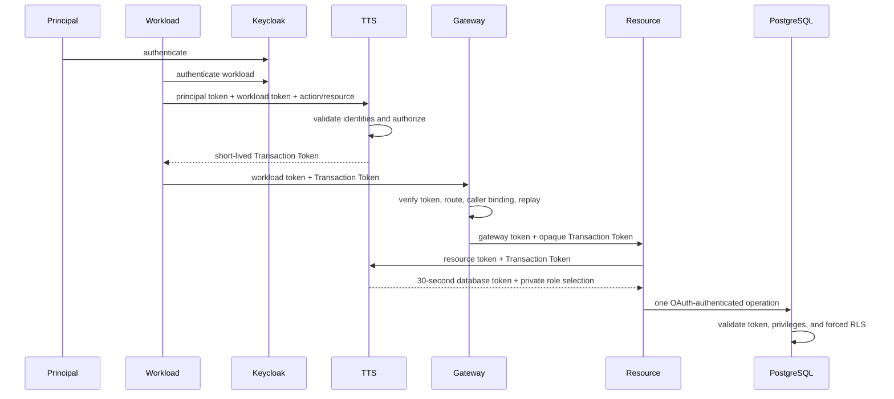

# Phase 1 implementation plan: identity and authorization spine

## Status

Implemented, with the scope subsequently narrowed to the zero-trust
authorization path. The earlier audit-ledger and dedicated JWKS-sync experiments
were removed; neither participates in the current architecture.

## Objective

Replace Phase 0's sentinel token with real identity, signed Transaction Tokens,
a separately signed PostgreSQL access-token profile, and forced multi-tenant
row-level security. Demonstrate that intermediary workload credentials do not
confer patient-data authority.

## Implemented flow



## Deliverables

1. Keycloak realm with Authorization Code + PKCE for humans and separate
   client-credentials identities for workloads and machine principals.
2. TTS implementing the pinned Transaction Token and RFC 8693 exchange profile.
3. Independent Ed25519 keys, issuers, audiences, types, and lifetimes for
   Transaction Tokens and database access tokens.
4. Gateway validation of signature, route/action/resource binding,
   authenticated `req_wl`, and receiver-local replay.
5. Opaque resource hop that cannot choose tenant, row profile, or database role.
6. PostgreSQL 18 OAuth validator with exact action-to-role checks and immutable
   `system_user` context.
7. Shared operation roles, `NOLOGIN` ownership, `NOBYPASSRLS` runtimes, and
   forced tenant/profile RLS.
8. Atomic publication of the database issuer public key directly by the TTS to
   a volume mounted read-only by PostgreSQL.
9. Redacted operational logs and negative tests for token substitution,
   malformed credentials, replay, route mismatch, role mismatch, and RLS escape.

## Acceptance criteria

- A workload credential by itself cannot mint a database token or read patient data.
- Callers cannot supply tenant, access profile, capability, or database role.
- The gateway rejects a Transaction Token obtained by a different workload.
- The resource forwards the compact Transaction Token byte-for-byte.
- PostgreSQL validates only database-audience tokens and fails closed on malformed input.
- Org administrators see tenant rows, providers see assigned patients, and patients see only themselves.
- Private provider calendars are not exposed to patient scheduling authority.
- No dedicated key synchronization, ledger, or audit-shipping process is required to run the demo.

## Verification

```sh
make check
make demo
make logs
```

The demo checks exact row IDs and appointment properties, then runs a malformed
OAuth credential against PostgreSQL to prove that the boundary fails closed.
