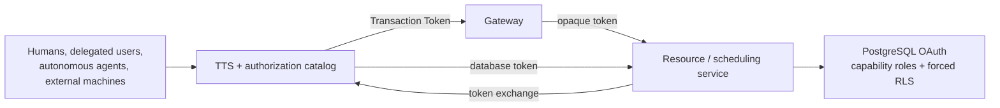

# Custody: zero-trust application architecture plan

## Goal

Build an open-source portfolio POC showing that applications, APIs, gateways,
and agents do not need standing access to patient data. Each operation derives
a short-lived database capability from the authority of the actual principal,
and PostgreSQL independently enforces both the operation and permitted rows.

The four principal paths are:

1. a user acting through an application;
2. a user acting through a delegated chat agent;
3. an autonomous internal agent with an explicit org-, provider-, or
   patient-scoped grant;
4. an external machine using an API.

## Core invariants

1. Workload credentials authenticate workloads; they never provide patient-data authority.
2. Principal tokens are consumed at transaction ingress and are not propagated through the internal chain.
3. A short-lived Transaction Token binds principal, optional delegated actor, requesting workload, action, resource, tenant, and row profile.
4. Callers request business actions and typed resources, never database roles.
5. Only the resource boundary can exchange a valid Transaction Token for a 30-second PostgreSQL access token.
6. PostgreSQL validates the database token offline and checks the requested role against the signed action.
7. Shared database roles represent narrow operations; immutable `system_user` context drives forced RLS.
8. Org admins see tenant rows, providers see assigned patients, and patients see only themselves.
9. Every component validates before trusting claims or causing a non-database side effect.

## Architecture

The TTS owns two independent Ed25519 issuers. It publishes only the database
issuer public key to a shared volume mounted read-only by PostgreSQL. This keeps
database authentication offline without a dedicated synchronization service.

## Phase 0 — feasibility spike

Status: complete.

- Repository, Compose stack, CI, Make targets, and security documentation.
- PostgreSQL 18 OAuth validator ABI spike.
- Accepted-token and malformed-token fail-closed demonstrations.
- Initial Transaction Token, AuthZEN, and database-token contracts.

## Phase 1 — identity and authorization spine

Status: complete. See [phase-1-implementation-plan.md](phase-1-implementation-plan.md).

- Keycloak PKCE human flow and separate machine/workload identities.
- RFC 8693 exchange into a pinned Transaction Token profile.
- Gateway token, route, requesting-workload, and replay validation.
- Opaque resource hop and resource-only database-token endpoint.
- Independent database token profile and offline PostgreSQL validation.
- Shared operation roles, protected object ownership, and forced multi-tenant RLS.
- Redacted teaching logs for the live end-to-end flow.

## Phase 2A — generalized principals and scheduling

Status: complete. See [phase-2-implementation-plan.md](phase-2-implementation-plan.md).

- Separate `principal_kind` from `access_profile`.
- Exercise all four principal paths through one pipeline.
- Provider access limited to assigned patients.
- Patient chat agent can read public provider availability and create a bounded appointment.
- Availability and appointment creation use different actions and database capabilities.
- External exporter and autonomous provider-scoped agent cannot self-escalate.

## Phase 2B — external policy and approval

Status: planned.

- Replace the fixture authorization catalog decision with an AuthZEN-compatible PDP.
- Add requestable denial, independently authenticated approval, fresh policy evaluation, and timeout denial.
- Bind the resulting decision to Transaction Token issuance without exposing database-role selection.

## Phase 2C — integration ergonomics

Status: planned.

- Define protobuf annotations for business actions and typed resources.
- Generate client/interceptor code for token acquisition and opaque propagation.
- Keep policy and action-to-database-role mapping out of callers and sidecars.

## Optional Phase 3 — workload attestation

- Replace static development client secrets with SPIFFE/SPIRE identities.
- Add mTLS between workloads.
- Demonstrate attenuated sub-agent delegation.

## Demo acceptance criteria

- The org administrator receives records `101,102,103`, provider 17 receives
  assigned records `101,102`, patient 101 receives only `101`, and tenant-B row
  `201` never escapes.
- The delegated patient sees only public provider-17 availability and schedules
  only patient 101 into signed slot 812.
- The autonomous and external machine paths retain their own bounded authority.
- No request accepts `org_id`, `access_profile`, `db_capability`, or `db_role`.
- A malformed PostgreSQL OAuth credential is rejected.
- `make logs` makes the complete exchange understandable without exposing tokens,
  secrets, patient records, or SQL bind values.

## Non-goals

- Durable audit or compliance logging.
- Production entitlement administration.
- Production key rotation, HSM/KMS integration, HA, or disaster recovery.
- Managed PostgreSQL platforms that cannot load the validator module.
- Formal verification or a claim of production readiness.
